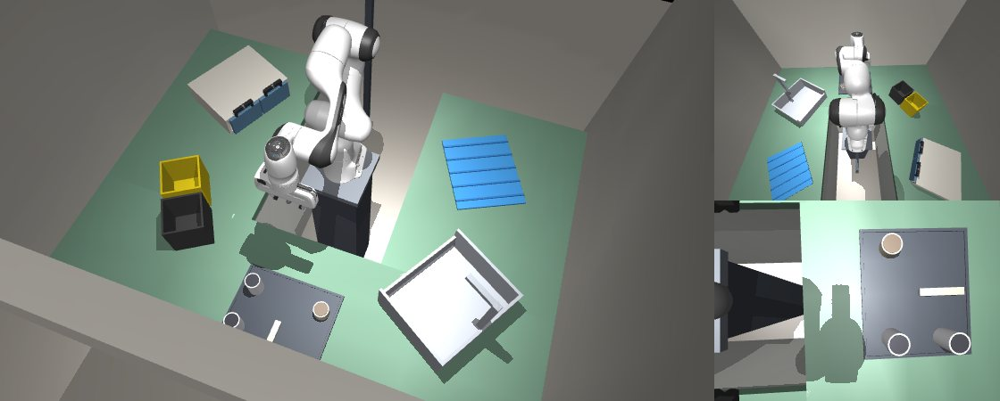

# Botnes SiteShift

The kitchen changed. Can the robot still finish its task?

SiteShift is a robotics simulation prototype built for the Nebius × NVIDIA Global AI Hackathon. A Franka Panda arm inspects a kitchen, looks for a sponge, then scrubs a bowl or asks for help. You can start a new simulation on your Mac and watch the robot move.



## Play the simulation

The simulator currently requires macOS. It has been tested on one Apple silicon Mac. Install [uv](https://docs.astral.sh/uv/getting-started/installation/) and git, then run these commands from the repository folder:

```sh
sh setup.sh
./start.command
```

Open [localhost:8766](http://127.0.0.1:8766/) in your browser. Choose a situation and click **Play simulation**. The page starts a new MuJoCo calculation and displays an overview, the robot camera and the wrist camera while it runs. Nothing starts until you click.

The three situations took about 24 to 33 seconds in local checks on this Mac, including startup. Other machines may take longer. The first pass is computing and rendering, so movement can look uneven. Once it finishes, click **Replay movements** for smoother playback of the saved images. That button does not start a second simulation. Playback is accelerated.

Click **Run analysis** to read that run's evaluator results and its comparison with the recorded reference. You can stop a running episode. Each run keeps its own images and records under `viewer/runs/`; the code, recordings and earlier runs are not replaced.

Setup downloads Python packages and a pinned Panda model. Running the demo needs no API key, GPU or cloud service. Keep the launcher window open while using the page. See the [viewer guide](viewer/README.md) for the controls and troubleshooting.

## Why build this?

I want robots to work toward a goal even when their surroundings change, with less programming of every possible situation. SiteShift explores a small part of that problem: noticing a change, preserving uncertainty and checking what actually happened.

The intended audience is robotics developers and integrators testing manipulation tasks. A possible use is to reproduce a changed environment, inspect a failure and compare software revisions. That usefulness still needs validation with other teams.

This prototype does not yet plan its own actions freely. The inspection route and gestures are programmed. The current scope is one development kitchen, one arm and one task, with simulated perception and uncalibrated physics. It has not demonstrated general-purpose autonomy, compatibility with arbitrary models or performance on a physical robot.

## What changes between the situations?

The mission stays the same: find the sponge, pick it up and scrub the bowl. The site file says the sponge is in drawer 0.

| Situation | What the recorded reference shows |
| --- | --- |
| Nothing moved | The robot finds the sponge in drawer 0 and scrubs the bowl. |
| Sponge moved | The sponge and spray bottle have swapped drawers. The robot finds the sponge in drawer 1 and scrubs the bowl. |
| Sponge hidden | A towel covers the sponge. The robot keeps that area marked “still to check” and asks for help. |

Each new local run is checked against those reference episodes. Differences are reported rather than hidden. These are three development examples, not a reliability estimate.

## Where NVIDIA and Nebius fit

Code builds a menu of valid next steps from the robot's own text summary. When both `scrub_bowl` and `ask_help` are valid, NVIDIA Nemotron 3 Super chooses between them through Nebius Token Factory. Code checks the answer again. Two real calls were recorded for the main demo. When only `ask_help` is valid, a rule takes it without a model call.

The visual launcher recalculates physics but reuses those recorded choices. A choice is accepted only if the new request text matches the recorded request exactly; otherwise the client refuses it. There is no live model call while you play. Nemotron does not inspect images, control the arm, write the report or grade the result. The robot's perception uses simulated depth and object labels.

The repository also includes a second pilot: 960 episodes of an existing AssembleNIST peg insertion policy, run unchanged in a CPU only Nebius AI Cloud Serverless Job. It separates success recorded during an episode from insertion at report time and documents errors in our own report. No Nemotron or retraining was used in that pilot. See [assembly_pilot](assembly_pilot/README.md).

## Recorded evidence and known limits

**Recorded evidence** in the visual launcher opens the earlier website. It replays stored episodes and checks the robot's report against the evaluator's records. It does not display your new local run. Across its three main reports, 22 of 39 claims are confirmed, none are contradicted and 17 cannot be checked. Those are counts, not a success rate.

On other operating systems, you can view that recorded website without installing the simulator:

```sh
python3 -m http.server 8765 --bind 127.0.0.1 --directory site
```

Open [localhost:8765](http://127.0.0.1:8765/). This requires Python 3.8 or later and calls no model.

The robot cannot lift cloth. A separate diagnostic found an unresolved failure with a thin cloth reported as the catalog towel. Calibration contact is exempt from the bench's contact rule despite exceeding 20 N. The second pilot also makes errors on whether a part is held. These limits and the difference between observed, reported and checked results are documented in [Claims](docs/CLAIMS.md), [Architecture](docs/ARCHITECTURE.md), [Testing](docs/TESTING.md) and [Provenance](docs/PROVENANCE.md).

The simulator's [command-line guide](simulator/README.md) remains available. The [public model client](docs/TESTING.md) reconstructs a request in dry-run mode by default; optional live calls are separate from this demo and require your own credentials and budget.

## License and credits

[Apache 2.0](LICENSE). [NOTICE](NOTICE) lists software, models and attribution. The simulator uses [MuJoCo](https://github.com/google-deepmind/mujoco), NumPy and the Franka Panda model from [MuJoCo Menagerie](https://github.com/google-deepmind/mujoco_menagerie), downloaded separately. Model weights are not distributed. This project is not endorsed by the companies named here.

Built with AI coding assistants Claude and Codex. The frozen simulator is unchanged by the visual launcher; the viewer adds a spectator renderer and reads the resulting records. Tests and reproduction checks are described in [Testing](docs/TESTING.md).
