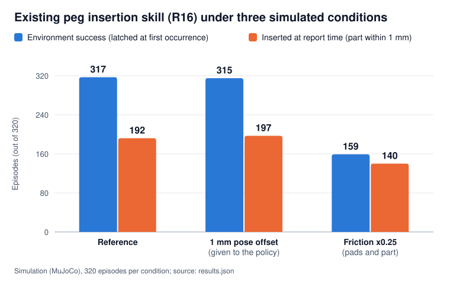

# Second pilot: an existing skill under a physical change and a pose error

**Simulation only (MuJoCo). No physical robot. No retraining, no adaptation. Nemotron is not used in this pilot.**

This folder is a secondary example next to the main SiteShift demo. It asks a narrow question: when the physical
conditions change, or the part pose given to it is off, what happens to a skill that someone else already trained,
and which of the robot's own statements about the outcome hold up against the simulator's records? Same idea as
SiteShift, on another skill: a robot-side report whose claims are checked against the simulator's records, and which
answers "still to check" when its own signals cannot settle the main claim.



## What was tested

- **The skill:** the pretrained policy of AssembleNIST by Tao Sun (MIT license), used as is: checkpoint
  `e8192_it12500.pt` (iteration 12,500), upstream commit `eb5d15e004591d380c0d521da67e025ebee37703`. AssembleNIST is
  one reinforcement-learning policy for the 20 assemblies of NIST Assembly Task Board 1; this pilot evaluates it on
  one of them only, the peg insertion task R16. Its author describes it as an independent implementation of the
  approach introduced by the AlphaNIST and Success Guided Sampling (SGS) papers, containing no code from those
  projects and not affiliated with or endorsed by their authors. It is not NVIDIA code. See [References](#references).
- **The task:** R16, a 16 mm round peg inserted into its hole on the NIST assembly board, by a simulated Franka
  Panda arm in MuJoCo. The policy receives the simulator's exact part pose at every step (no camera perception),
  offset by 1 mm in the second condition.
- **Three conditions, fixed before any result,** 320 episodes each (10 seeds x 32 trials), paired: same start
  states and same policy noise in all three.

| Condition | What changes |
| --- | --- |
| Reference | Nominal physics; start states drawn as in the author's evaluation (built in the Job with the author's script) |
| 1 mm pose offset | The part position given to the policy is off by 1 mm horizontally (the simulated world is unchanged) |
| Friction x0.25 | Sliding friction x0.25 on the gripper pads (2.0 to 0.5) and on the part (0.75 to 0.1875) |

## How it ran

One Nebius AI Cloud Serverless Job, CPU only (16 vCPU, 64 GiB of memory, AMD EPYC, no GPU), with no secret inside
the container, on October 26, 2026 (UTC). It ran 6 preliminary episodes, then the 960 main episodes. About 7 min 14 s
passed from the creation request to the first observation of the finished Job (23:18:27 to 23:25:41 UTC; our watcher
read the Job's state about every 15 s; from the launcher records, which are not included here).
The simulation of the **960 main episodes** took 74.7 s (26.3 + 26.5 + 21.9 s, from `results.json`); the 6
preliminary episodes ran in a separate phase of about 26 s, rendering and export included. The rest went to
provisioning, installing dependencies, building the start states (46.4 s) and rendering two videos.
The bill for this Job has not been checked yet, so no cost is stated here.

## Results

Two measures, kept separate on purpose:

- **Environment success:** the upstream environment's own predicate (part keypoints within 1 mm, no simultaneous
  safety failure, within 15 s), **latched at its first occurrence**. The episode keeps running to 15 s afterwards.
- **Inserted at report time:** the part keypoints are within 1 mm in the simulator **at the instant of the robot's
  report**. That instant is the end of the 15 s episode for 942 of the 960 episodes; the 18 reports of a safety
  fault stop at the detection instant. It is a different measure from environment success.

| Condition (320 episodes each) | Environment success | Inserted at report time | Success, not inserted at report time | Safety faults (environment flag) |
| --- | ---: | ---: | ---: | ---: |
| Reference | 317 | 192 | 125 | 3 |
| 1 mm pose offset | 315 | 197 | 118 | 5 |
| Friction x0.25 | 159 | 140 | 19 | 10 |

**How to read "success, not inserted at report time".** For these episodes, `audit.json` gives the environment's
keypoint distance at the report instant (`truth.d_asm_mm`). Almost all of them are just past the 1 mm threshold,
not far from the hole: in the reference, all 125 are between 1.0 and 1.9 mm (median 1.2 mm); with the 1 mm offset,
117 of 118 are at 2.0 mm or less (range 1.0 to 2.01 mm, median 1.3 mm); with friction x0.25, 17 of 19 are at 2.0 mm
or less (median 1.2 mm), and the other two are at 2.03 and 38.2 mm. Over the three conditions, 259 of these 262
episodes are at 2.0 mm or less. Every episode counted as inserted at report time is at 1.0 mm or less.

Paired against the reference, on environment success: with friction x0.25, 158 episodes with environment success in
the reference lose it, and none goes the other way (exact McNemar test, p below 1e-40). With the 1 mm offset: 3 and 1
(p = 0.625).

## Our robot-side report and its audit

After each episode, a retrospective reporter (ours, not part of AssembleNIST) reads only robot-side signals: joint
positions and speeds, finger positions, its own commands, the kinematic model and the board layout. It never stops or
changes the controller. It makes one main claim: `inserted`, `not inserted`, `safety fault detected`, or
`still to check`.

An audit then checks **two predicates only** against the simulator's records at the report instant: the main claim
when it is `inserted` or `not inserted` (part keypoints, 1 mm), and "part held" (both fingers in geometric contact
with the part, within 0.5 mm; this does not prove a stable grasp). Everything else in a report (speeds, gripper
opening, tool position, estimated push) is a diagnostic and is not audited.

| Main claim (960 episodes) | Count | Checked against the simulator's records |
| --- | ---: | --- |
| still to check | 928 | an abstention, not scored |
| not inserted | 14 | 14 confirmed, 0 contradicted |
| inserted | 0 | never claimed |
| safety fault detected | 18 | consistency check only: it reads the same joint-velocity monitor as the environment's flag (18 of 18 agree) |

**"Part held" disagrees with the audit 32 times out of 960: 30 false positives and 2 false negatives.** Most of the
960 statements say "not held" (889), so the rate to read is this one: **the report said "held" 71 times, and 30 of
those were wrong** (the audit finds the part not held by both fingers): 3 of 8 in the reference, 5 of 10 with the
1 mm offset, 22 of 53 with friction x0.25. It said "not held" 889 times, and 2 of those were wrong. Disagreements by
condition: 4 (reference), 5 (1 mm offset) and 23 (friction x0.25).

## What this shows, and what it does not

It shows that a physical change can degrade an existing skill: with friction x0.25, environment success falls from
317 to 159 of 320, and 158 paired episodes with environment success in the reference lose it, with none the other
way. A 1 mm offset in the part position given to the policy barely changes it in this batch. It also shows the
limits of a simple robot-side report: it abstains on 928 of 960 episodes, never claims an insertion, and its "part
held" statement disagrees with the audit 32 times (30 of its 71 "held" were wrong). We show those errors rather than
hide them.

It does not show adaptation or retraining (none happened), a real robot, camera perception, or force sensing (forces
are estimates from commanded joint torques; the model has no force sensor). It is a single task in one batch, in a
simulator not calibrated to a real robot. The raw 25 Hz signals were not exported, so the audit can be recounted
and cross-checked from these files, but not fully recomputed.

## How to recount

```sh
python3 recount.py results/
```

Python 3.8 or later (it uses `math.comb`), standard library only; tested with Python 3.9.6 and 3.12.13. It prints
the same JSON as `recount_output.json` and exits with 0 when every cross-check agrees and every recounted count and
keypoint distance equals its expected value (a distance at the number of decimals written here). The expected values
are the constants `STATED` written in `recount.py`: the numbers this README states for the batch published on
October 27, 2026. The script does not read this README at run time, so a change to these numbers must be made in
both places. It also prints the simulation time of the 960 main episodes (74.7 s, from `results.json`); the other
times come from the launcher records, not included. It checks each file's sha256 against the
`evidence_manifest.json` written inside the Job.
`results/SHA256SUMS` lists the files' sha256 (`sha256sum -c SHA256SUMS` or `shasum -a 256 -c SHA256SUMS` from
inside `results/`).

## Files

- `results/`: six of the files the Job exported, byte-identical: `results.json` (one record per episode),
  `audit.json`, `robot_reports.jsonl`, `summary.json`, `plan.json` (written before the first episode),
  `evidence_manifest.json`. The per-condition copies and the start-state bank files that the Job also exported are
  not included; `evidence_manifest.json` lists them with their sha256.
- `recount.py`, `recount_output.json`: the independent recount and its output.
- `chart.svg`, `slide_1280x720.png`: the chart above and a video slide, drawn from `recount_output.json`.
- `trial/`: the four program files that ran inside the Job, byte-identical to what ran: `run_trial.py`,
  `evidence_export.py`, `job_entry.sh`, `requirements.txt`. They fetch and import the upstream code inside a
  disposable container only. `job_entry.sh` stops unless it runs on Linux x86-64, as root, with
  `BOTNES_DISPOSABLE_JOB=1`, with its injected files readable under `/opt` and with no secret-like environment
  variable or credentials file visible; it does not prove by itself that it runs in a cloud Job. Their comments were
  left as they ran, including references to internal review notes. The trial's synthetic unit tests are not included
  here: their shared helper contains a path specific to the development machine, and we chose not to edit a file
  that had been reviewed.

## Third parties

AssembleNIST code: MIT license, copyright 2026 Tao Sun. It was fetched inside the Job only and is not redistributed
here. Its NIST board assets come from UW Lab, and their redistribution license is marked "to be confirmed" upstream,
so this folder contains **no upstream mesh, render, image or video**: only our own outputs. MuJoCo (Apache-2.0),
the Franka Panda model from MuJoCo Menagerie (Apache-2.0; AssembleNIST's scene builder edits it in memory) and
PyTorch were installed in the Job and are not included here. Our files in this folder are under the repository's
Apache-2.0 license.

## References

AssembleNIST asks users to cite it together with AlphaNIST and SGS. The entries below are taken from its
`CITATION.bib` and `THIRD_PARTY.md` (author lists shortened to "et al."). The links come from those files; each one
was opened on October 27, 2026.

- Tao Sun. *AssembleNIST: One Policy for All NIST Board Assemblies in MuJoCo*. 2026.
  <https://github.com/suniique/assembly-nist>
- Zhang et al. *AlphaNIST: Emergent Assembly Skills from Binary Task Rewards*. arXiv preprint arXiv:2610.13354,
  2026. <https://alpha-nist.github.io/>
- Zhang et al. *A Balanced Data Diet: Addressing the Exploration Bottleneck in Mega-Scale RL for Robot Control*
  (Success Guided Sampling, SGS). arXiv preprint arXiv:2610.12465, 2026. <https://sgs-rl.github.io/>

Its `CITATION.bib` also lists the simulator and the arm model used in the pilot:

- Emanuel Todorov, Tom Erez and Yuval Tassa. *MuJoCo: A physics engine for model-based control*. IEEE/RSJ
  International Conference on Intelligent Robots and Systems (IROS), 2012.
- Kevin Zakka, Yuval Tassa and the MuJoCo Menagerie Contributors. *MuJoCo Menagerie: A collection of high-quality
  simulation models for MuJoCo*. 2022. <https://github.com/google-deepmind/mujoco_menagerie>
